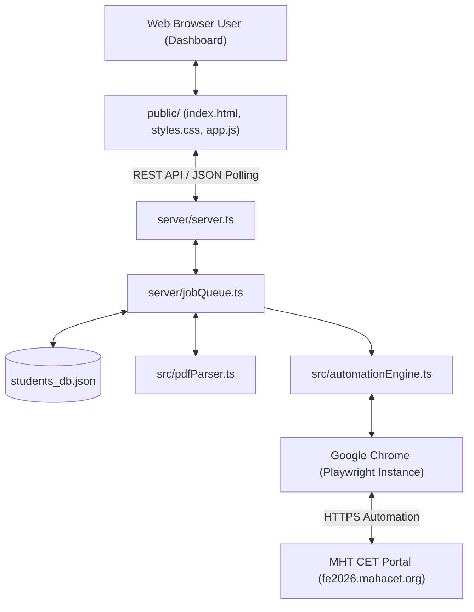

# MHT CET Engineering Choice Filling Automation Portal
## Technical Onboarding & Project Documentation

---

## 1. Project Overview

### What This Project Does
The **MHT CET Engineering Choice Filling Automation Portal** is a production-ready, full-stack web application and Playwright browser automation suite built to automate the official Maharashtra Common Entrance Test (MHT CET) CAP Option Form choice filling process for First-Year B.E. / B.Tech engineering admissions.

It replaces manual, error-prone entry of dozens or hundreds of 10-digit engineering institute choice codes with an automated pipeline that:
1. **Parses Student Preference PDFs**: Extracts candidate metadata (Name, Registration ID, Category, Counselor) and 100% of 10-digit Choice Codes alongside Branch / Course Names from counselor-generated preference list PDFs.
2. **Auto-Formats Choice Codes**: Normalizes 9-digit choice codes (or 9 digits with suffix letters `F`/`L`/`T`/`U`) by prepending a leading zero `'0'` (e.g., `317524610` ➔ `0317524610`).
3. **Automates MHT CET Portal Navigation**: Authenticates candidates via MHT CET Keycloak Auth, navigates through the CAP Registration portal, and attaches to the official candidate module (`fe2026.mahacet.org`).
4. **Executes 4-Step Option Filling Sequence**:
   - **Step 1 (`frmShortListOptions`)**: Shortlists Choice #1 by selecting course name from dropdown, searching institutes, checking choice code, and adding options.
   - **Step 2 (`frmSetPreferences`)**: Selects preference checkboxes and saves preferences.
   - **Step 3 (`frmOptionFormSummary`)**: Clicks **Insert Choice Code Directly** (`#rightContainer_ContentTable3_btnInsertDirect`).
   - **Step 4 (`frmInsertChoiceCodeDirect`)**: Loops through all PDF choice codes, enters codes, clicks **Verify Choice Code**, sets exact PDF rank positions in `ddlPreferenceNo`, skips already added choices gracefully, clicks **Insert Choice Code** (`#rightContainer_ContentTable1_btnInsertDirect`), and submits with **Save & Proceed >>>** (`page.getByRole('button', { name: 'Save & Proceed >>>' })`).
5. **Provides a Real-Time Management Dashboard**: Offers an Obsidian-Dark glassmorphic Web Portal UI for uploading PDFs, managing candidate credentials, starting single or batch jobs, observing live terminal logs, and viewing screenshot proof lightboxes.

### Primary Objective
Eliminate manual choice entry errors and drastically reduce option filling time from 45+ minutes per student to under 35 seconds per candidate.

### Target Users
- **Educational Counselors & Admission Centers**: Processing high volumes of student preference lists during CAP admission rounds.
- **Students & Parents**: Seeking fast, error-free choice submission on the official MHT CET portal.

### Major Features
- **PDF Extraction Engine (`pdf-parse`)**: Regex-based extraction of metadata and choice codes.
- **Automatic 9-Digit Code Formatter (`formatChoiceCode`)**: Automatically prepends leading `'0'` to truncated codes.
- **Obsidian Dark Web Dashboard**: Single-page application built with HTML5, CSS Grid/Flexbox, Vanilla JS, and Lucide Icons.
- **Live Terminal Feed**: Real-time worker activity logs streamed via polling API.
- **Screenshot Proof Lightbox**: Saves visual proof of submission (`screenshots/screenshot_<ID>.png`).
- **Batch Processing Queue**: Async background job queue with queue length monitoring and non-blocking worker pool execution.

---

## 2. Tech Stack

| Category | Technology | Usage / Purpose |
| :--- | :--- | :--- |
| **Language** | TypeScript / JavaScript (Node.js) | Primary development language for server, API, automation, and PDF engine. |
| **Runtime & Runner**| `Node.js` (v18+) & `tsx` (v4.23.1) | On-the-fly TypeScript execution without requiring a separate compilation step. |
| **Web Server** | `Express.js` (v5.2.1) | REST API server on port 3000 handling student data, uploads, and automation status. |
| **Browser Automation** | `@playwright/test` (v1.62.0) | Chromium / Google Chrome native browser automation framework. |
| **PDF Parser** | `pdf-parse` (v2.4.5) | PDF text stream extraction library for reading preference list PDFs. |
| **File Upload** | `multer` (v2.2.0) | Express middleware for handling multipart/form-data PDF file uploads. |
| **Environment Mgmt**| `dotenv` (v17.4.2) | Environment variable management loader (`.env`). |
| **CORS Middleware** | `cors` (v2.8.6) | Cross-Origin Resource Sharing enablement for API endpoints. |
| **Frontend Styling** | Custom Vanilla CSS (Variables, Glassmorphism, CSS Grid) | Obsidian Dark Theme with HSL gradients, backdrop filters, and responsive layout. |
| **Frontend Script** | Vanilla ES6 JavaScript | Focus-preserving DOM state updater with live polling. |
| **UI Icons** | `Lucide Icons` (unpkg CDN) | Lightweight UI icons for dashboard controls. |
| **Database** | JSON Storage (`students_db.json`) | Persistent file-based document store for student profiles and status. |
| **Target Web Portal** | MHT CET Portal (`auth-2026` & `fe2026.mahacet.org`) | State Common Entrance Test Cell, Maharashtra State. |

---

## 3. Folder Structure

```
ENG-CHOICE_FILLING_AUTOMATION/
├── .env                                # Local environment credentials (MHTCET_EMAIL, MHTCET_PASSWORD)
├── package.json                        # Node.js project manifest, dependencies, and npm start script
├── playwright.config.ts                # Playwright configuration (Chrome/Edge channels, timeouts, traces)
├── students_db.json                    # File-based JSON database storing active student records
├── students_choices_summary.json       # Exported summary of PDF choice extraction results
├── PROJECT_DOCUMENTATION.md            # Comprehensive project documentation & onboarding guide
│
├── public/                             # Web Portal Frontend Static Assets
│   ├── index.html                      # Glassmorphic Obsidian Dark dashboard UI
│   ├── styles.css                      # Modern CSS design system (variables, animations, custom table)
│   └── app.js                          # Client-side state manager, focus-preserving table renderer, polling
│
├── server/                             # Express REST API & Background Worker Queue
│   ├── server.ts                       # Express server initialization, static routes, REST API endpoints
│   └── jobQueue.ts                     # Background job manager, student database CRUD, worker runner
│
├── src/                                # Core Business Logic & Automation Drivers
│   ├── pdfParser.ts                    # PDF text parser, metadata extraction, formatChoiceCode helper
│   ├── automationEngine.ts             # Programmatic Playwright worker runner for Web Portal jobs
│   ├── batchRunner.ts                  # Batch PDF extraction script across Students Data/ folder
│   └── testPdfExtractor.ts             # CLI test runner for verifying PDF extraction
│
├── tests/                              # Playwright Test Suites
│   └── mhtcet_navigation.spec.ts       # E2E test spec verifying login, shortlisting, and direct insertion
│
├── screenshots/                        # Generated Verification Screenshot Proofs
│   ├── step1_login_page.png
│   ├── step11_insert_direct_page.png
│   ├── step12_choice_1_verified.png
│   ├── step13_option_form_saved_final.png
│   └── screenshot_<STUDENT_ID>.png
│
└── Students Data/                      # Storage folder for candidate preference list PDFs
    └── Preference List - *.pdf
```

---

## 4. Prerequisites

Before setting up and running this project, ensure your machine satisfies the following requirements:

- **Operating System**: Windows 10/11 (or Linux/macOS).
- **Node.js**: `v18.0.0` or higher (`v22.x` recommended). Verify with `node -v`.
- **Package Manager**: `npm` (v9+ recommended, bundled with Node.js). Verify with `npm -v`.
- **System Browser**: Installed **Google Chrome** or **Microsoft Edge** browser. Playwright is configured to use native system browser channels (`channel: 'chrome'`) to bypass missing OS DLL dependencies.
- **Java / Python**: Not required.
- **Database**: No external SQL/NoSQL database required (uses local `students_db.json`).
- **Environment File**: A valid `.env` file containing candidate credentials for direct testing.

---

## 5. Installation Steps

Follow these step-by-step instructions to set up the project on a fresh machine:

### Step 1: Unzip or Clone Repository
Navigate to your desired workspace directory and extract or clone the repository:
```bash
cd c:\Users\mrsum\OneDrive\Desktop\PLAYWRIGHT\ENG-CHOICE_FILLING_AUTOMATION
```

### Step 2: Install Node.js Dependencies
Run `npm install` to install Express, Playwright, pdf-parse, tsx, and types:
```bash
npm install
```

### Step 3: Install Playwright Browsers (Optional / System Chrome Recommended)
Install Playwright browser binaries if needed:
```bash
npx playwright install chrome
```

### Step 4: Configure Environment Variables
Create or edit `.env` in the root project directory:
```ini
MHTCET_EMAIL=srushtiijadhav5@gmail.com
MHTCET_PASSWORD=Srushti@123
PORT=3000
```

### Step 5: Start the Web Portal Server
Launch the Express server using `npm start`:
```bash
npm start
```

### Step 6: Access Dashboard
Open your browser and navigate to:
```text
http://localhost:3000
```

---

## 6. Environment Variables

The project uses a `.env` file located in the root directory.

| Variable Name | Required | Description | Default Value |
| :--- | :--- | :--- | :--- |
| `MHTCET_EMAIL` | Yes | Candidate registered email address used for MHT CET portal login during test runs. | `srushtiijadhav5@gmail.com` |
| `MHTCET_PASSWORD` | Yes | Candidate portal password associated with `MHTCET_EMAIL`. | `Srushti@123` |
| `PORT` | No | Express Web Server listening port. | `3000` |

---

## 7. Project Architecture

### Overall Architecture



### Request Lifecycle
1. **Student Registration / PDF Upload**: User fills candidate details on `http://localhost:3000` and uploads a preference list PDF.
2. **PDF Parsing & Storage**: `server.ts` routes the request to `multer`, saves the PDF in `Students Data/`, triggers `parseStudentPdf()` in `pdfParser.ts`, extracts all choice codes with `formatChoiceCode()`, and persists the record into `students_db.json`.
3. **Job Enqueueing**: User clicks **`▶ Start Automation`**. `jobQueue.ts` updates status to `Queued` and puts the job into `jobQueue[]`.
4. **Automation Worker Execution**: Worker thread pops job ID, updates status to `Running`, launches Playwright Chrome instance via `runStudentAutomation()`, and executes portal login, shortlisting, preference setting, and direct choice code insertion.
5. **Real-Time Terminal Streaming & Status Update**: Playwright worker emits progress % and log messages, which `jobQueue.ts` stores in `logs[]`. Client `app.js` polls `/api/automation/status` every 1.2s and updates the dashboard without destroying active input focus.
6. **Proof Screenshot Generation**: Upon completion, Playwright saves `screenshots/screenshot_<ID>.png`, sets status to `Completed (100%)`, and closes the browser.

---

## 8. Important Configuration Files

### `package.json`
- Defines project metadata, dependencies (`express`, `pdf-parse`, `@playwright/test`, `tsx`, `multer`, `dotenv`), and execution script `"start": "tsx server/server.ts"`.

### `playwright.config.ts`
- Playwright configuration file:
  - `testDir`: Configured to `./tests`.
  - `workers`: Set to `1` worker to prevent parallel session conflicts on MHT CET Auth.
  - `projects`: Configured with system browser channels (`Google Chrome` via `channel: 'chrome'`, `Microsoft Edge` via `channel: 'msedge'`).
  - `use`: Configured with `viewport: { width: 1280, height: 720 }`, `trace: 'on-first-retry'`, `screenshot: 'on'`.

### `.env`
- Holds active candidate testing credentials and portal server port configuration.

### `students_db.json`
- Persistent storage file acting as a document database for student candidate records, credentials, extracted choice lists, progress, status, and screenshot URLs.

---

## 9. Scripts

Available npm scripts defined in `package.json`:

| Command | Action / Executed Command | Description |
| :--- | :--- | :--- |
| `npm start` | `tsx server/server.ts` | Launches Express Web Server on port 3000 using `tsx` on-the-fly TypeScript execution. |
| `npx playwright test` | `npx playwright test --project="Google Chrome"` | Runs Playwright E2E automation test spec `tests/mhtcet_navigation.spec.ts` in headed Chrome. |
| `npx tsx src/batchRunner.ts` | `npx tsx src/batchRunner.ts` | Executes batch PDF parser across all PDF files in `Students Data/` directory. |

---

## 10. How to Start Development

### Developer Workflow
1. **Starting the Web Server**:
   Run `npm start` in your terminal. The dashboard will be available at `http://localhost:3000`.
2. **Modifying Frontend Components**:
   - `public/index.html`: Update markup for dashboard controls or modal forms.
   - `public/styles.css`: Modify CSS variables (e.g. `--bg-dark-core`, `--accent-cyan`) or layout cards.
   - `public/app.js`: Adjust DOM rendering logic or event listeners. Uses selective DOM updating to preserve active focus during 1.2s polling.
3. **Modifying Automation Logic**:
   - `src/automationEngine.ts`: Programmatic Playwright worker used by the Web Portal.
   - `tests/mhtcet_navigation.spec.ts`: CLI Playwright test suite for rapid isolated testing.
4. **Testing Choice Code Formatting**:
   Ensure `formatChoiceCode()` in `src/pdfParser.ts` correctly handles 9-digit codes (`317524610` ➔ `0317524610`) and letter-suffixed codes (`627624550F` ➔ `0627624550F`).

---

## 11. Build & Deployment

### Development / Local Deployment
The application is designed to run locally on the admission counselor's Windows machine to handle live candidate choice filling during CAP rounds.
- **Run**: `npm start`
- **Port**: `3000`

### Production Bundle Considerations
- Node.js runtime (v18+) with native Google Chrome installed.
- Ensure write permissions for `Students Data/`, `screenshots/`, and `students_db.json`.

---

## 12. Testing

### Playwright E2E Testing Suite
- **Framework**: `@playwright/test`
- **Test Location**: `tests/mhtcet_navigation.spec.ts`
- **Execution Command**:
  ```bash
  npx playwright test --project="Google Chrome"
  ```
- **Test Strategy**:
  1. Authenticates candidate using credentials in `.env`.
  2. Opens CAP registration and switches to candidate portal tab.
  3. Shortlists Choice #1 on `frmShortListOptions`.
  4. Checks preferences and saves on `frmSetPreferences`.
  5. Clicks **Insert Choice Code Directly** on `frmOptionFormSummary`.
  6. Loops through PDF choice codes on `frmInsertChoiceCodeDirect`, formats 9-digit codes to 10 digits, verifies choice codes, selects `ddlPreferenceNo`, skips already added choices gracefully, clicks `#rightContainer_ContentTable1_btnInsertDirect`, and submits via `Save & Proceed >>>`.
  7. Captures verification screenshots in `screenshots/`.

---

## 13. External Dependencies

| Dependency Type | Resource / Endpoint | Description |
| :--- | :--- | :--- |
| **Authentication Server** | `https://auth-2026.maharashtracet.org/realms/mh-cet/protocol/openid-connect/auth` | Keycloak OpenID Connect authentication server for MHT CET. |
| **Candidate Portal** | `https://fe2026.mahacet.org/CandidateModuleCAPRound1/` | Candidate option form submission module (`frmShortListOptions`, `frmSetPreferences`, `frmOptionFormSummary`, `frmInsertChoiceCodeDirect`). |
| **CDN Resources** | `https://unpkg.com/lucide@latest` | Lucide icon set for dashboard icons. |
| **Local File Storage** | `students_db.json`, `screenshots/`, `Students Data/` | Local filesystem storage for JSON records, screenshots, and uploaded PDFs. |

---

## 14. Common Issues & Troubleshooting

### Issue 1: Browser Launch Fails (`gkcodecs.dll missing` or Chromium crash)
- **Cause**: Default Playwright Chromium headless shell missing Windows OS codecs.
- **Solution**: The project is explicitly configured to use native Chrome (`channel: 'chrome'`). Ensure Google Chrome is installed on the system.

### Issue 2: Red Error Message "Invalid Choice Code or You are not eligible..."
- **Cause**: Choice code is 9 digits (missing leading zero) or choice code was already inserted in previous step.
- **Solution**: The engine automatically applies `formatChoiceCode()` (prepending `'0'`) and catches the red message gracefully to skip duplicates without worker crash.

### Issue 3: Express Port 3000 in Use
- **Cause**: Previous server instance still running in background.
- **Solution**: Stop running Node processes via task manager or run `npx kill-port 3000`.

### Issue 4: Credentials Rejected by Portal
- **Cause**: Invalid email or password provided for MHT CET Keycloak auth.
- **Solution**: Update candidate credentials in the Web Dashboard table or `.env` file.

---

## 15. Developer Notes & Conventions

### Coding Standards & Conventions
- **TypeScript**: Strict type definitions for student records (`StudentRecord`), choice items (`ChoiceItem`), and job configs (`StudentAutomationJobConfig`).
- **Selector Rules**: Always prefer explicit IDs or stable attributes:
  - Insert Choice Code Button: `#rightContainer_ContentTable1_btnInsertDirect`
  - Preference Number Dropdown: `#rightContainer_ContentTable1_ddlPreferenceNo`
  - Choice Code Input: `#rightContainer_ContentTable1_txtChoiceCode`
  - Verify Button: `#rightContainer_ContentTable1_btnVerifyChoiceCode`
  - Final Save Button: `page.getByRole('button', { name: 'Save & Proceed >>>' })`
- **Focus Preservation**: When updating client table UI in `public/app.js`, track `document.activeElement` and selection ranges to ensure editing credentials does not lose input focus during polling.

---

## 16. Future Improvements

1. **Multi-Worker Parallel Queue**: Expand `jobQueue.ts` to support configurable worker concurrency (e.g. 2-3 parallel Chrome contexts).
2. **WebSocket Log Streaming**: Replace 1.2s HTTP polling with Server-Sent Events (SSE) or WebSockets for instant log updates.
3. **Database Upgrade**: Migrate `students_db.json` to SQLite / Better-SQLite3 for higher concurrency during peak admission rounds.
4. **Automated CAP Round 2 Support**: Extend option form navigation to handle CAP Round 2 and Round 3 module URLs.

---

## 17. Quick Start Checklist

- [x] **1. Node.js Check**: Ensure Node.js v18+ is installed (`node -v`).
- [x] **2. Dependencies**: Run `npm install`.
- [x] **3. Environment Config**: Ensure `.env` exists with candidate credentials.
- [x] **4. Native Chrome**: Ensure Google Chrome browser is installed.
- [x] **5. Start Portal**: Run `npm start`.
- [x] **6. Open Dashboard**: Visit `http://localhost:3000`.
- [x] **7. Upload PDF**: Click `+ Add Student / PDF` and upload candidate preference PDF.
- [x] **8. Start Automation**: Click `▶ Start Automation` and monitor live progress!

---

## 18. AI Context (`AI_CONTEXT.md`)

```markdown
# AI CONTEXT: MHT CET Choice Filling Automation Portal

## Project Summary
This project is an automated web application and Playwright E2E automation engine designed to fill First-Year B.E./B.Tech Engineering option forms on the official Maharashtra Common Entrance Test (MHT CET) candidate portal (fe2026.mahacet.org).

## Core Problem Solved
Counselors manually enter dozens or hundreds of 10-digit institute choice codes per candidate during CAP admission rounds. This project parses candidate preference PDFs, formats choice codes, authenticates candidates, and uses Playwright browser automation to fill all choices automatically.

## Tech Stack & Architecture
- **Language & Runtime**: TypeScript / JavaScript, Node.js v18+, tsx (TypeScript runner).
- **Backend API & Queue**: Express.js (server/server.ts), multer for uploads, custom async queue (server/jobQueue.ts).
- **Automation Driver**: Playwright (@playwright/test) launching native system Chrome (channel: 'chrome').
- **PDF Engine**: pdf-parse (src/pdfParser.ts) extracting student metadata and choice codes.
- **Frontend Dashboard**: Obsidian dark glassmorphism SPA (public/index.html, styles.css, app.js) running on http://localhost:3000.
- **Database**: File-based JSON storage (students_db.json).

## Key Business Logic Rules
1. **formatChoiceCode(code)**: Any choice code with 9 digits (or 9 digits + suffix letter e.g., 317524610 or 627624550F) MUST be prepended with a leading '0' (e.g., 0317524610, 0627624550F).
2. **Navigation Flow**: Auth Portal -> CAP Registration -> Technical Education -> Bachelor of Engineering -> candidate portal (fe2026.mahacet.org).
3. **Choice Insertion Steps**:
   - Shortlists Choice #1 on frmShortListOptions.
   - Sets preferences on frmSetPreferences (input#rightContainer_ContentTable1_btnProceed).
   - Clicks Insert Choice Code Directly (#rightContainer_ContentTable3_btnInsertDirect) on frmOptionFormSummary.
   - Loops through ALL PDF choices on frmInsertChoiceCodeDirect: fills txtChoiceCode, clicks btnVerifyChoiceCode, selects ddlPreferenceNo (PDF rank position), skips already added choices gracefully, clicks #rightContainer_ContentTable1_btnInsertDirect.
   - Clicks Save & Proceed >>> (page.getByRole('button', { name: 'Save & Proceed >>>' })).

## Key File Map
- server/server.ts: Express API endpoints (/api/students, /api/automation/*).
- server/jobQueue.ts: Job queue manager & student storage CRUD.
- src/pdfParser.ts: PDF text parser & formatChoiceCode helper.
- src/automationEngine.ts: Programmatic Playwright worker runner for web portal jobs.
- tests/mhtcet_navigation.spec.ts: Isolated Playwright E2E test suite spec.
- public/app.js: Client SPA state manager with focus-preserving 1.2s polling UI.
```
